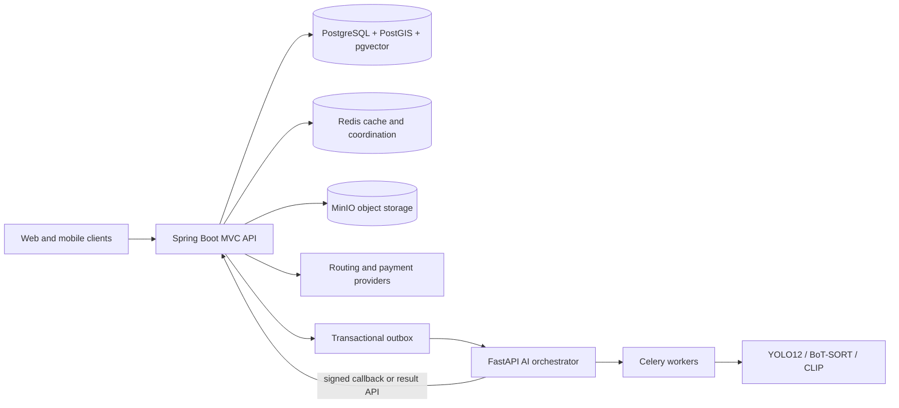

# SignTrustMap Backend Outline

## 1. Scope and Architecture Decision

This repository should contain the core SignTrustMap business backend implemented as
a Java 21 Spring Boot MVC application. Start as a modular monolith: it keeps
transactions, authorization, auditing, and deployment manageable while preserving
clear module boundaries that can be extracted later if load or team ownership makes
that necessary.

The Java service replaces the NestJS business service proposed in the project
description. Python remains the appropriate boundary for FastAPI, YOLO12, BoT-SORT,
CLIP, coordinate projection, and Celery workers. Heavy video and model processing
must not run in Spring MVC request threads.



Recommended ownership:

- Spring Boot owns users, RBAC, surveys and their states, review assignments,
  consensus, verified signs, catalog governance, credits, payments, moderation,
  navigation sessions, configuration, and audit history.
- Python owns media decoding, GPX synchronization, detection and tracking,
  geometric projection, embeddings, classification, active-learning scoring, and
  model training/evaluation.
- PostgreSQL is the system of record. Redis is never the only source of business
  state. MinIO stores binary objects; PostgreSQL stores object keys and metadata.

## 2. Source Layout

Use a three-layered package layout with controllers, services, and repositories at
the top level. Domain-specific classes remain grouped in subpackages inside each
layer so the technical boundaries are clear without losing feature context.

```text
src/main/java/com/signtrustmap/backend/
|-- SignTrustMapBackendApplication.java
|-- api/                     # API envelope and pagination
|-- config/                  # Jackson, JPA, Redis, scheduling, OpenAPI
|-- controller/              # HTTP presentation layer
|   |-- catalog/
|   |-- identity/
|   `-- signmap/
|-- service/                 # business use cases and transaction boundaries
|   |-- catalog/
|   |-- identity/
|   `-- signmap/
|-- repository/              # Spring Data JPA persistence layer
|   |-- catalog/
|   |-- identity/
|   `-- signmap/
|-- dto/                     # validated request and response records
|   |-- catalog/
|   |-- identity/
|   `-- signmap/
|-- entity/                  # JPA entities, enums, and shared persistence types
|   |-- catalog/
|   |-- identity/
|   `-- signmap/
`-- exception/               # API exception handler and business exceptions
```

Rules:

- Controllers validate HTTP input and delegate; they do not implement business
  rules or access repositories directly.
- Application services define use cases and transaction boundaries.
- Domain objects enforce state transitions and invariants.
- JPA entities are not returned from APIs. Map them to explicit response DTOs.
- Cross-module work uses application interfaces or domain events, not another
  module's JPA repository.

## 3. Domain Modules

### 3.1 Identity and Access

Responsibilities: registration, credential login, Google OAuth2, token refresh,
account lifecycle, roles, permissions, reviewer profile, and device/session records.

Core records: `User`, `Role`, `Permission`, `UserRole`, `OAuthIdentity`,
`RefreshToken`, `ReviewerProfile`.

Roles are additive because one community user may be a Driver, Surveyor, and
Reviewer: `DRIVER`, `SURVEYOR`, `REVIEWER`, `STAFF`, `ADMIN`.

### 3.2 Traffic Sign Catalog

Responsibilities: public catalog browsing; admin create/update/disable/merge;
controlled version publication; representative images; labeling guidance; CLIP
prompts; OSM mapping rules; AI label-set synchronization.

Core records: `SignCategory`, `SignType`, `CatalogVersion`, `CatalogVersionItem`,
`CatalogImage`, `MissingTypeReport`, `MissingTypeReportLink`.

Catalog drafts must not affect active classification. Only one published version is
active, and publication creates an immutable snapshot used by candidates and model
runs.

### 3.3 Survey Submission and Upload

Responsibilities: create a submission, choose `VIDEO_GPX` or `SINGLE_PHOTO`, issue
resumable/chunked upload sessions, validate completion, persist media metadata,
enqueue extraction, and expose processing history/progress.

Core records: `SurveySubmission`, `UploadSession`, `MediaAsset`, `TrajectoryAsset`,
`SubmissionProcessingEvent`.

Suggested status progression:

```text
DRAFT -> UPLOADING -> VALIDATING -> QUEUED -> PROCESSING
                                      |          |
                                      |          +-> PARTIALLY_PROCESSED
                                      |          +-> NO_SIGN_DETECTED
                                      |          +-> COMPLETED
                                      |          `-> FAILED
                                      +-> PENDING_CORRECTION
                                      `-> REJECTED
```

Upload design:

- Prefer direct multipart uploads from clients to MinIO using short-lived presigned
  URLs. Spring creates and finalizes the upload session but does not proxy large
  video bytes.
- Persist expected size, MIME type, checksum, object key, part count, and upload
  owner. Completion must verify object metadata and be idempotent.
- Reward eligibility is decided after processing/validation rules, not merely after
  a file is uploaded.

### 3.4 Candidate Pool and AI Integration

Responsibilities: accept idempotent AI results, store unverified candidates and
evidence, track model/catalog versions, spatial confidence, direction, duplicate
links, active-learning priority, and validation eligibility.

Core records: `TrafficSignCandidate`, `CandidateEvidence`, `Prediction`,
`CandidateFlag`, `CandidateDuplicateLink`, `AiJob`, `AiJobEvent`.

Important candidate fields: source submission, sign crop and context object keys,
predicted sign type, confidence, bounding-box metadata, estimated `Point`, spatial
confidence, heading/direction, embedding, detector/classifier versions, catalog
version, selection reason, and status.

The Spring-to-Python contract should be versioned and idempotent:

1. A committed survey emits `SurveyQueued` through a transactional outbox.
2. A dispatcher calls the FastAPI orchestration endpoint with an idempotency key.
3. FastAPI enqueues Celery work and returns an external job ID.
4. Python reports progress/results through a signed callback, or Spring polls a
   result endpoint if callbacks are unavailable.
5. Spring validates the callback schema, job ownership, and idempotency key before
   applying candidate/result state in one transaction.

Do not publish directly to Celery's private Redis task protocol from Java. Treat the
FastAPI endpoint as the stable integration boundary.

### 3.5 Review and Consensus

Responsibilities: priority queue loading, exclusive short-lived assignment,
approve/reject/correct/flag decisions, review history, weighted consensus,
reliability updates, rewards, and escalation.

Core records: `ReviewAssignment`, `ReviewDecision`, `ConsensusResult`,
`ReliabilityChange`.

Decision values: `APPROVE`, `REJECT`, `CORRECT_LABEL`, `FLAG`. Store the reviewer's
reliability snapshot with each decision so a later score change does not rewrite
history.

Consensus should be deterministic and configurable. Given vote value `v` (`1` for
approval and `-1` for rejection) and reliability snapshot `w`, use a normalized
weighted score:

```text
score = sum(w_i * v_i) / sum(w_i)
```

Apply minimum-review, approval, rejection, conflict, fraud, and duplicate rules.
Finalization must be atomic: lock the candidate, create one result, create/update a
verified sign when approved, issue ledger rewards once, update reliability history,
and write audit/outbox events. A unique consensus result per candidate prevents
double payouts and duplicate publication.

### 3.6 Verified Sign Map

Responsibilities: viewport and proximity queries, sign details, filtering,
direction-aware route queries, manual corrections, issue reports, version history,
activation/retirement, and spatial export.

Core records: `VerifiedSign`, `VerifiedSignVersion`, `SignIssueReport`.

Store positions as PostGIS `geography(Point, 4326)` (or a consistently chosen
`geometry(Point, 4326)` if planar operations dominate), add a GiST index, and store
heading in degrees `[0, 360)`. Keep historical versions immutable. Map APIs should
query by viewport/geohash/proximity and paginate; never return the entire inventory.

Direction matching should use a configurable angular tolerance and define behavior
for signs whose direction is unknown or bidirectional.

### 3.7 Revalidation

Responsibilities: find stale signs, publish viewport task pins, accept evidence,
enforce distance/daily limits, route evidence to review, refresh/update/retire a
verified sign, preserve history, and reward accepted work.

Core records: `RevalidationTask`, `RevalidationEvidence`, `RevalidationDecision`.

Statuses: `OPEN`, `EVIDENCE_PENDING_REVIEW`, `UNDER_REVIEW`, `CONFIRMED`, `CHANGED`,
`MISSING`, `ESCALATED`, `EXPIRED`, `CANCELLED`.

### 3.8 Wallet, Rewards, and Payments

Responsibilities: balances, immutable transactions, reward rules, daily tasks,
navigation charges, top-up packages, payment callbacks, refunds, manual adjustments,
and abuse holds.

Core records: `Wallet`, `CreditTransaction`, `RewardRule`, `DailyTaskDefinition`,
`DailyTaskProgress`, `TopUpPackage`, `Payment`, `PaymentEvent`.

Use an append-only credit ledger. Every transaction has an idempotency key, source
type/source ID, signed amount, resulting balance, actor, and timestamp. Lock the
wallet row for balance-changing transactions. Never trust payment redirect results;
apply top-ups only after a verified, idempotent server webhook.

### 3.9 Navigation

Responsibilities: start/end sessions, charge credits atomically, integrate a routing
provider, query relevant verified signs along a route corridor, and record session
activity.

Core records: `NavigationSession`, `NavigationCharge`, `RouteSnapshot`.

The client should perform frequent position updates and local alert presentation.
The backend returns direction-filtered upcoming signs in route segments and refreshes
them after rerouting. Avoid storing every raw GPS sample unless a documented product
or safety requirement justifies the privacy and storage cost.

### 3.10 Moderation, Administration, and Audit

Responsibilities: moderation queues, suspicious submissions/GPS/evidence, map
overrides, account sanctions, configuration, exports, pipeline controls, and a
complete audit trail.

Core records: `ModerationCase`, `ModerationAction`, `UserSanction`, `SystemSetting`,
`SettingVersion`, `AuditEvent`, `ExportJob`.

System settings that affect decisions must be versioned or snapshotted on the result
(consensus thresholds, rewards, freshness rules). Audit entries should record actor,
action, target, request/correlation ID, timestamp, and a safe before/after summary.

### 3.11 MLOps

Responsibilities: active-learning selection settings, training requests, datasets,
model evaluation metadata, deployment approval, active model pointers, catalog-label
synchronization, and reprocessing of missing-type candidates.

Core records: `ModelVersion`, `TrainingDataset`, `TrainingJob`, `EvaluationResult`,
`ModelDeployment`, `CandidateSelectionRun`.

Python performs training and inference. Spring owns who may trigger a run, which
catalog/dataset/model versions were selected, approval state, audit records, and the
active configuration exposed to Python.

## 4. REST API Outline

Use `/api/v1` and JSON unless an export or media operation requires another content
type. List endpoints use cursor pagination for fast-changing queues and offset/page
pagination only for stable administration lists.

| Area | Main endpoints |
| --- | --- |
| Auth | `POST /auth/register`, `/auth/login`, `/auth/refresh`, `/auth/logout`; OAuth2 authorization/callback |
| Profile | `GET/PATCH /me`, `GET /me/contributions`, `GET /me/reviewer-stats` |
| Catalog | `GET /catalog/categories`, `GET /catalog/sign-types`, `GET /catalog/sign-types/{id}` |
| Surveys | `POST /surveys`, `POST /surveys/{id}/uploads`, `POST /surveys/{id}/complete`, `GET /surveys`, `GET /surveys/{id}`, `GET /surveys/{id}/events` |
| Review | `POST /review-assignments/next`, `POST /review-assignments/{id}/decisions`, `GET /reviews/history` |
| Missing types | `POST /candidates/{id}/missing-type-reports`, `GET/PATCH /staff/missing-type-reports/{id}` |
| Map | `GET /signs?bbox=...`, `GET /signs/{id}`, `GET /signs/nearby`, `POST /signs/{id}/reports` |
| Revalidation | `GET /revalidation-tasks?bbox=...`, `GET /revalidation-tasks/{id}`, `POST /revalidation-tasks/{id}/evidence` |
| Wallet | `GET /wallet`, `GET /wallet/transactions`, `GET /daily-tasks`, `POST /daily-tasks/{id}/claim` |
| Payments | `GET /top-up-packages`, `POST /payments`, `GET /payments/{id}`, `POST /webhooks/payments/{provider}` |
| Navigation | `POST /navigation-sessions`, `POST /navigation-sessions/{id}/route`, `GET /navigation-sessions/{id}/upcoming-signs`, `DELETE /navigation-sessions/{id}` |
| Moderation | `GET /staff/cases`, `GET /staff/cases/{id}`, `POST /staff/cases/{id}/actions` |
| Admin | users/roles/settings/catalog versions/exports/model jobs under `/admin/**` |
| AI internal | `POST /internal/ai/jobs/{id}/progress`, `POST /internal/ai/jobs/{id}/results` |

For processing progress, begin with persisted events plus polling. Add Server-Sent
Events at `GET /surveys/{id}/stream` only if the clients need live updates; WebSocket
is unnecessary for one-way status notifications.

## 5. Persistence Outline

Use separate Flyway migrations and table prefixes or schemas aligned with modules.
The first migration should enable required extensions:

```sql
CREATE EXTENSION IF NOT EXISTS postgis;
CREATE EXTENSION IF NOT EXISTS vector;
```

Persistence conventions:

- UUID primary keys; `created_at`, `updated_at`, and optimistic `version` columns.
- UTC instants in storage and APIs; clients localize for display.
- `snake_case` database names and explicit constraints/indexes.
- Check constraints for headings, confidence values, nonnegative balances, and valid
  state-specific fields.
- Unique idempotency keys for uploads, AI callbacks, consensus, rewards, and payment
  events.
- GiST spatial indexes and HNSW/IVFFlat vector indexes only after query dimensions
  and expected volume are known.
- Soft deletion only where recovery/history is a business need. Prefer explicit
  `DISABLED`, `RETIRED`, or `REJECTED` states over a universal `deleted_at`.
- Use an `outbox_event` table for reliable cross-process events.

## 6. Security and API Rules

- Add Spring Security, JWT resource-server support, OAuth2 client support, and
  method-level authorization.
- Hash local passwords with an adaptive password hash; never log credentials,
  access tokens, payment payload secrets, or presigned object URLs.
- Use short-lived access tokens and rotated, hashed refresh tokens.
- Require ownership checks in services, not only URL-level role checks.
- Protect internal AI callbacks with TLS plus service credentials/signatures and
  timestamp/replay validation.
- Validate MIME type, declared size, actual size, checksum, and object ownership for
  uploads. Scan untrusted files before processing where deployment permits.
- Add rate limits for login, upload creation, review assignment, rewards, reports,
  navigation starts, and payment endpoints.
- Use RFC 9457 Problem Details for consistent errors and include a correlation ID.
- Apply CORS explicitly per environment. Do not use wildcard origins with
  credentials.

## 7. Spring and Infrastructure Additions

The current `pom.xml` already includes MVC, JPA, Flyway, PostgreSQL, Redis, MinIO,
and basic test starters. The implementation will also need, at minimum:

- Spring Security, Validation, OAuth2 client, and OAuth2 resource server.
- Actuator for health/readiness/metrics.
- Hibernate Spatial for PostGIS mapping.
- A documented JWT library only if Spring Security cannot cover token issuance.
- OpenAPI tooling for generated API documentation.
- Testcontainers for PostgreSQL/PostGIS, Redis, and MinIO integration tests.
- A mapping approach such as explicit mappers or MapStruct; do not put mapping logic
  in controllers.

Configuration changes required before feature development:

- Change Hibernate `ddl-auto` from `create` to `validate`; Flyway owns the schema.
- Disable SQL logging by default and configure it only in a local profile.
- Move Docker Compose credentials to environment files/secrets for non-local use.
- Add environment-specific profiles, structured logging, health checks, and graceful
  shutdown.
- Pin container image versions, including MinIO.

## 8. Testing Strategy

- Domain unit tests: state machines, consensus thresholds, direction matching,
  reliability changes, wallet invariants, freshness, and reward eligibility.
- MVC slice tests: validation, authorization, response shapes, and error mapping.
- Repository tests against real PostGIS: viewport, proximity, route corridor, spatial
  indexes, and vector queries.
- Integration tests with Testcontainers: migrations, MinIO upload finalization,
  Redis caching/locks, outbox dispatch, and idempotent AI/payment callbacks.
- Contract tests between Spring and FastAPI for versioned job and result payloads.
- End-to-end tests for the critical chains: upload to candidate, review to publish,
  revalidation to update/retire, and payment/reward to ledger balance.
- Load tests for chunk initialization/finalization, review queue assignment, viewport
  sign queries, and navigation upcoming-sign queries.

## 9. Delivery Sequence

### Phase 0 - Foundation

Set up security, API/error conventions, Flyway/PostGIS, base entities, audit and
outbox foundations, MinIO client, CI, Testcontainers, profiles, and observability.

### Phase 1 - Identity, Catalog, and Read-Only Map

Implement users/RBAC/OAuth2, catalog read/admin versioning, verified sign storage,
viewport/detail queries, and initial administration settings.

### Phase 2 - Survey Ingestion and AI Contract

Implement resumable direct-to-MinIO uploads, survey processing state/history,
outbox dispatch, FastAPI job integration, progress callbacks, and candidate storage.

### Phase 3 - Review, Consensus, and Publishing

Implement the validation queue, decisions/corrected labels/flags, missing-type
reports, weighted consensus, reviewer reliability, moderation escalation, verified
sign publishing, and idempotent rewards.

### Phase 4 - Revalidation and Wallet

Implement freshness scheduling, task map queries, evidence submission/review,
sign versioning/retirement, immutable credit ledger, daily tasks, and contribution
rewards.

### Phase 5 - Payments and Navigation

Implement packages/payment webhooks/reconciliation/refunds, route-provider
integration, atomic navigation charging, route-corridor sign lookup, and session
history.

### Phase 6 - MLOps and Operations

Implement active-learning/model/catalog controls, unknown-candidate reprocessing,
spatial exports, operational dashboards, abuse controls, performance tuning, load
testing, backup/restore, and production hardening.

## 10. First Implementation Slice

The first vertical slice should prove the architecture without involving AI:

1. Run Flyway against PostGIS with `users`, `sign_category`, `sign_type`,
   `verified_sign`, and `audit_event` tables.
2. Authenticate an admin and a community user with JWT-based APIs.
3. Let the admin create and publish a small catalog version.
4. Seed several verified signs and query them by bounding box and category.
5. Cover authorization and spatial queries with Testcontainers.

After that slice is stable, add survey upload and the versioned FastAPI contract.
This sequence addresses the riskiest backend foundations early while providing a
usable catalog/map API to frontend and mobile teams.
