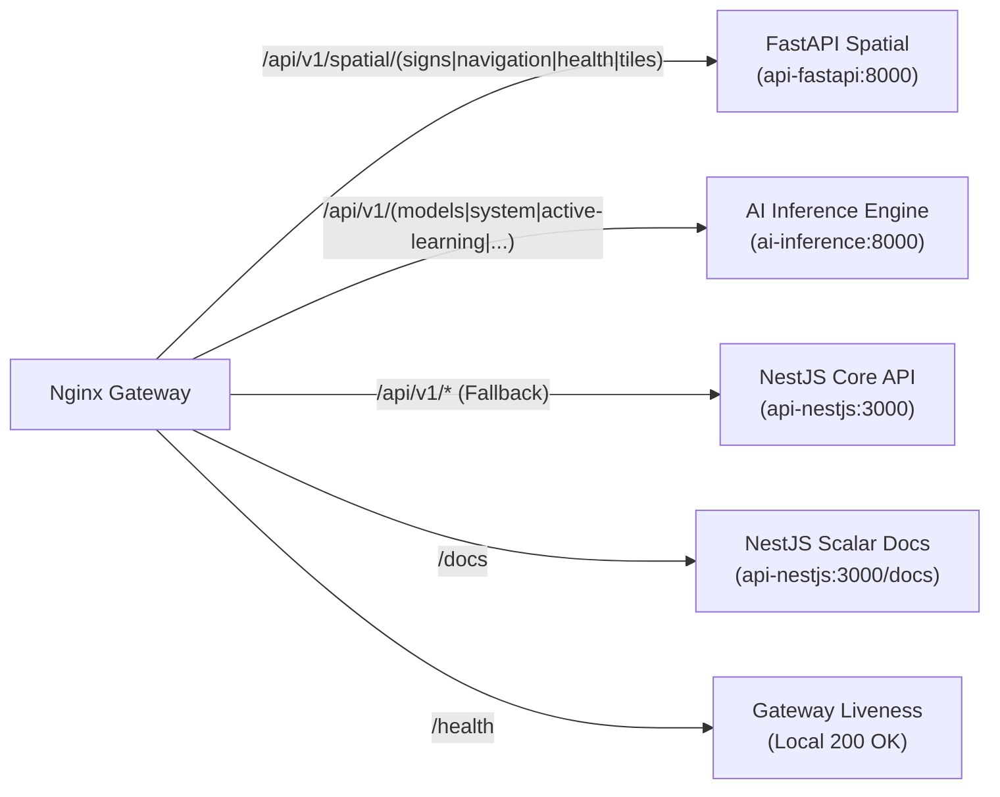

# 03 — Gateway & Reverse Proxy Routing Conventions

This guide defines how incoming traffic is routed through the **API Gateway (Nginx)** to **NestJS**, **FastAPI**, and **AI Jetson Orin**.

---

## 1. Nginx Routing Architecture & The Regex Trap

All public traffic arrives at `api.signmap.site` (Nginx Gateway on port 80/443). The gateway uses explicit path prefixes to route requests:



> [!WARNING]
> ### The Regex Trap: Adding New Routes in FastAPI or AI
> Look at the Nginx location block for FastAPI:
> ```nginx
> location ~ ^/api/v1/spatial/(signs|navigation|health|tiles) {
>     proxy_pass http://api-fastapi:8000;
> }
> ```
> If a developer creates a new endpoint in FastAPI such as:
> ```python
> @router.get("/hazards/live") # full path: /api/v1/spatial/hazards/live
> ```
> Nginx **will NOT match** this location block! The request will fall through to `location /api/v1`, proxy to NestJS, and return `404 Not Found`.
> 
> **Convention:** Whenever you introduce a new top-level sub-resource under FastAPI or AI, you **MUST** update [`signtrustmap-backend/infra/gateway/nginx.conf`](../../infra/gateway/nginx.conf) to include the new path in the regex:
> ```nginx
> location ~ ^/api/v1/spatial/(signs|navigation|health|tiles|hazards)
> ```

---

## 2. WebSocket Streaming Endpoints

For real-time navigation streaming (`/api/v1/spatial/navigation/stream`):
- Nginx must pass WebSocket connection upgrade headers:
  ```nginx
  proxy_set_header Upgrade $http_upgrade;
  proxy_set_header Connection $connection_upgrade;
  proxy_buffering off;
  proxy_cache off;
  ```
- Any new WebSocket endpoint must disable proxy buffering to avoid chunk delay in real-time driving alerts.

---

## 3. Large File Upload Limits

- The platform processes raw dashcam videos up to **2 GB (MP4)** for road survey uploads.
- The following timeout and size settings must be preserved:
  ```nginx
  client_max_body_size 2048M;
  client_body_buffer_size 512k;
  proxy_connect_timeout 60s;
  proxy_send_timeout 3600s;
  proxy_read_timeout 3600s;
  ```
- If an endpoint handles large file chunks (e.g. `/api/v1/submissions/chunks`), do **not** apply express body-parser middleware with small limits (e.g. `10mb`) to binary streams.
