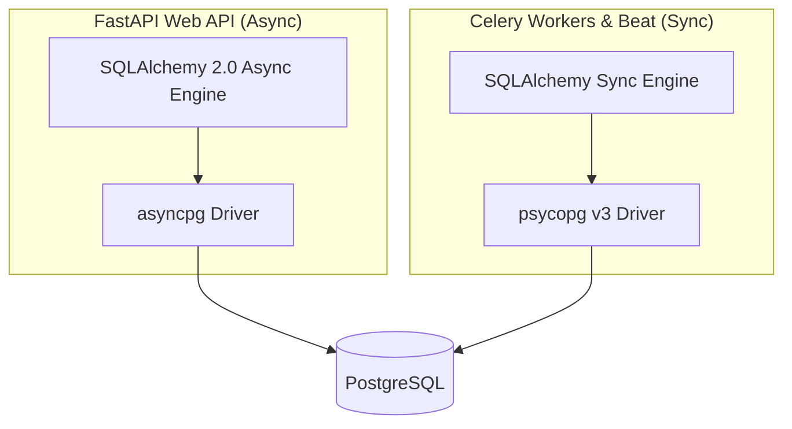

# 04 — Database & Asynchronous Worker Conventions

This guide defines database connection lifecycles, driver separations, and migration conventions across NestJS, FastAPI, and Celery workers.

---

## 1. Async vs. Sync Driver Separation (Crucial for FastAPI & Celery)

The backend interacts with PostgreSQL using **two distinct drivers**:



> [!CAUTION]
> ### The Asyncpg in Celery Trap:
> `asyncpg` operates strictly inside an active asyncio event loop. Celery worker threads run synchronously. 
> - **Never** import or execute `app.database.engine` or `get_db` from `app.api` inside Celery tasks in `app.tasks.*`.
> - **Always** use the dedicated synchronous database helper (`app.db_sync` using `postgresql+psycopg://...`).
> - Failing to do this causes `RuntimeError: There is no current event loop in thread` or deadlocks the Celery task queue.

---

## 2. Clean Connection Disposal on Shutdown (`lifespan`)

FastAPI must cleanly dispose of its async connection pool when a container stops or restarts (e.g. during a Coolify redeployment):

```python
# In app/main.py
@asynccontextmanager
async def lifespan(app: FastAPI):
    yield
    # Disposes all open asyncpg connection slots before process exits
    await engine.dispose()

app = FastAPI(..., lifespan=lifespan)
```
*Omitting `await engine.dispose()` causes leaked connection slots in PostgreSQL, eventually exhausting `max_connections` during frequent deployments.*

---

## 3. The `synchronize: false` Rule (NestJS / TypeORM)

TypeORM in [`app.module.ts`](../../apps/nestjs/src/app.module.ts) is configured with:
```typescript
TypeOrmModule.forRootAsync({
  useFactory: (config: ConfigService) => ({
    type: 'postgres',
    autoLoadEntities: true,
    synchronize: false, // ⚠️ MANDATORY: Never set to true in production!
    extra: { max: 20 },
  }),
})
```

- **`synchronize: false` is strictly required.** Enabling `synchronize: true` in production drops columns, re-creates tables unpredictably, and breaks PostGIS spatial indexes.
- All schema changes must be applied via SQL migration files managed by the migration container (`postgres-migrate`).

---

## 4. PostGIS and pgvector Native Types

The database uses PostGIS for spatial geometric calculations and pgvector for AI embedding similarity:
- Spatial queries must use standard ST functions (`ST_SetSRID`, `ST_MakePoint`, `ST_DWithin`, `ST_MakeEnvelope`).
- Always use SRID **4326** (WGS 84 coordinate reference system: longitude, latitude).
- AI vector searches must use cosine distance operator `<=>` or inner product `<#>` on indexed vector columns.

---

## 5. Strict Zero Raw SQL Policy (TypeORM & SQLAlchemy ORM)

### Rule:
- **Never** invoke `.query()` on `DataSource`, `EntityManager`, or `Repository` in NestJS.
- **Never** invoke `sa_text()` or `text()` for standard table queries in FastAPI.
- **Never** execute raw database queries in Controllers. Controllers must delegate persistence to Services.

### Why:
Raw SQL queries bypass TypeScript entity types, skip TypeORM lifecycle hooks/subscribers, cause `snake_case` vs `camelCase` DTO mapping errors, and risk SQL injection vulnerabilities through manual string concatenation.

### Approved Patterns:
1. **Basic CRUD**: Inject and use TypeORM `Repository<T>` (`findOne`, `find`, `save`, `update`, `delete`).
2. **PostGIS Spatial Queries**: Use TypeORM `createQueryBuilder` with parameter binding or `SpatialQueryHelper`:
   ```typescript
   // ✅ RECOMMENDED:
   return await this.verifiedSignRepo
     .createQueryBuilder('vts')
     .where('ST_DWithin(vts.location::geography, ST_SetSRID(ST_MakePoint(:lon, :lat), 4326)::geography, :radius)', {
       lon,
       lat,
       radius,
     })
     .getMany();

   // ❌ FORBIDDEN:
   return await this.dataSource.query('SELECT * FROM verified_traffic_signs WHERE ST_DWithin(...)');
   ```
3. **Dynamic Conditions**: Use `qb.andWhere()` chaining with named parameters. Never assemble SQL using string concatenation (`${whereClause}`).
4. **Mandatory Raw SQL Exceptions**: For Postgres maintenance operations where no ORM construct exists (e.g., `REFRESH MATERIALIZED VIEW` or writable `WITH ... MATERIALIZED` CTEs), an explicit ESLint disable comment with documented rationale is required:
   ```typescript
   // eslint-disable-next-line no-restricted-syntax -- approved-raw-sql: PostgreSQL materialized view refresh cannot be performed via TypeORM ORM
   await this.dataSource.query('REFRESH MATERIALIZED VIEW CONCURRENTLY mv_community_leaderboard');
   ```
5. **Unit Tests**: Always mock repositories using `createMockRepository<T>()` from `common/test/mock-repository`. Never omit repository mocks and force services to fall back to `dataSource.query`.

