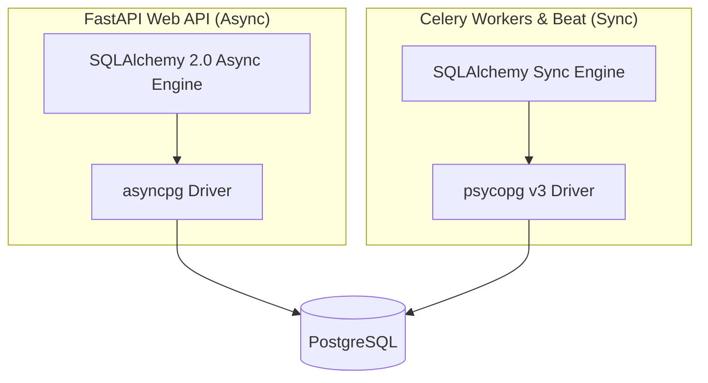

# 04 — Database & Asynchronous Worker Conventions

This guide defines database connection lifecycles, driver separations, and migration conventions across NestJS, FastAPI, and Celery workers.

---

## 1. Async vs. Sync Driver Separation (Crucial for FastAPI & Celery)

The backend interacts with PostgreSQL using **two distinct drivers**:



> [!CAUTION]
> ### The Asyncpg in Celery Trap:
> `asyncpg` operates strictly inside an active asyncio event loop. Celery worker threads run synchronously. 
> - **Never** import or execute `app.database.engine` or `get_db` from `app.api` inside Celery tasks in `app.tasks.*`.
> - **Always** use the dedicated synchronous database helper (`app.db_sync` using `postgresql+psycopg://...`).
> - Failing to do this causes `RuntimeError: There is no current event loop in thread` or deadlocks the Celery task queue.

---

## 2. Clean Connection Disposal on Shutdown (`lifespan`)

FastAPI must cleanly dispose of its async connection pool when a container stops or restarts (e.g. during a Coolify redeployment):

```python
# In app/main.py
@asynccontextmanager
async def lifespan(app: FastAPI):
    yield
    # Disposes all open asyncpg connection slots before process exits
    await engine.dispose()

app = FastAPI(..., lifespan=lifespan)
```
*Omitting `await engine.dispose()` causes leaked connection slots in PostgreSQL, eventually exhausting `max_connections` during frequent deployments.*

---

## 3. The `synchronize: false` Rule (NestJS / TypeORM)

TypeORM in [`app.module.ts`](../../apps/nestjs/src/app.module.ts) is configured with:
```typescript
TypeOrmModule.forRootAsync({
  useFactory: (config: ConfigService) => ({
    type: 'postgres',
    autoLoadEntities: true,
    synchronize: false, // ⚠️ MANDATORY: Never set to true in production!
    extra: { max: 20 },
  }),
})
```

- **`synchronize: false` is strictly required.** Enabling `synchronize: true` in production drops columns, re-creates tables unpredictably, and breaks PostGIS spatial indexes.
- All schema changes must be applied via SQL migration files managed by the migration container (`postgres-migrate`).

---

## 4. PostGIS and pgvector Native Types

The database uses PostGIS for spatial geometric calculations and pgvector for AI embedding similarity:
- Spatial queries must use standard ST functions (`ST_SetSRID`, `ST_MakePoint`, `ST_DWithin`, `ST_MakeEnvelope`).
- Always use SRID **4326** (WGS 84 coordinate reference system: longitude, latitude).
- AI vector searches must use cosine distance operator `<=>` or inner product `<#>` on indexed vector columns.
