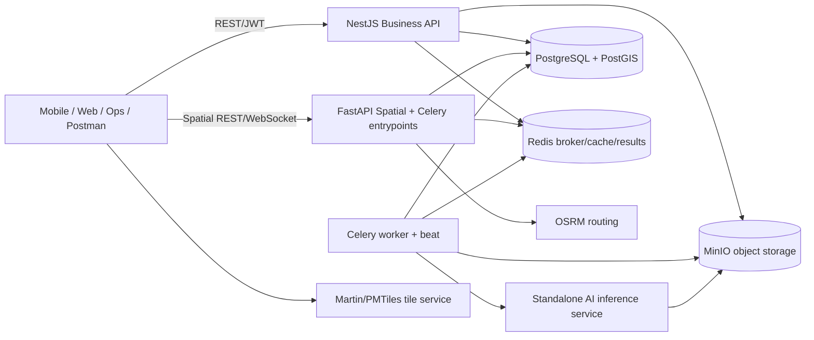
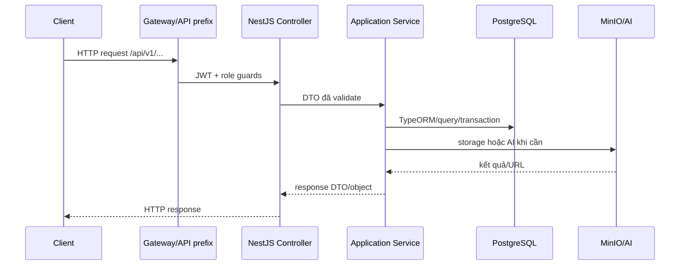

# 2. Kiến trúc hệ thống

## Thành phần thực tế

Nguồn chính: `README.md` phần System Architecture; `docker-compose.yml`; `apps/nestjs/src/main.ts`; `apps/nestjs/src/app.module.ts`; `apps/fastapi/app/main.py`; `signtrustmap-ai/src/main.py`.

## Request flow điển hình

## Nhận xét kiến trúc

- NestJS dùng feature-first modules, TypeORM repository và service application layer.
- FastAPI xử lý spatial/navigation và gắn Celery cho pipeline/background work.
- MinIO tách media khỏi database; PostgreSQL giữ metadata và quan hệ.
- Một số đường đi dùng raw SQL trong service cùng với TypeORM; cần chú ý khi review transaction/schema.

## SR-12: Chi tiết tích hợp OSRM Routing Engine & Martin Tile Server

Theo cam kết Review 2 (SR-12), kiến trúc hệ thống tích hợp hai thành phần hạ tầng GIS chuyên dụng:

### 1. OSRM Routing Engine (`osrm-routed`)
- **Vai trò:** Cung cấp động cơ dẫn đường phương tiện tốc độ cao (Open Source Routing Machine) dựa trên dữ liệu OpenStreetMap (OSM) của Việt Nam.
- **Cấu hình Container:** Chạy image `ghcr.io/project-osrm/osrm-backend:v5.27.1` tại cổng nội bộ 5000 (`http://osrm-routed:5000`).
- **Giao diện & Tích hợp:**
  - `apps/fastapi` gọi OSRM HTTP API (`/route/v1/driving/...`) qua `routing.service.ts` / `spatial.py` để tính toán hành trình tối ưu, khoảng cách và thời gian di chuyển.
  - Hỗ trợ đa profile: Ô tô (`driving`) và xe máy (`motorcycle`).
  - Hỗ trợ định vị hành lang biển báo dọc tuyến đường (route-aware sign lookup / along-route corridor).

### 2. Martin Tile Server (`tile-server`)
- **Vai trò:** Máy chủ phân phối Vector Tiles và Raster Tiles viết bằng Rust (`ghcr.io/maplibre/martin:v0.13.0`), phục vụ bản đồ nền mượt mà và tối ưu băng thông cho client Mobile & Web.
- **Cấu hình Container:** Chạy tại cổng 8085 (`http://tile-server:8085`), đọc trực tiếp từ thư mục chứa file PMTiles nén (`pmtiles/vietnam.pmtiles`).
- **Giao diện & Tích hợp:**
  - Client (MapLibre GL JS trên Web/Ops Portal, MapLibre Native trên Mobile) kết nối trực tiếp đến Martin Tile Server qua chuẩn TileJSON (`/vietnam/{z}/{x}/{y}`) để render bản đồ ngoại tuyến / trực tuyến tốc độ cao mà không gây tải cho PostgreSQL.

