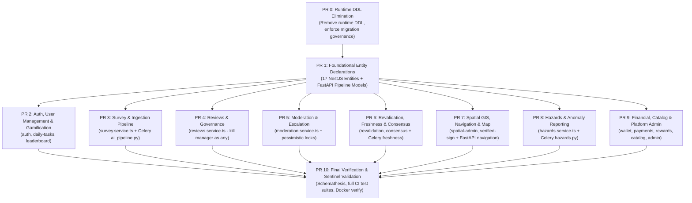

# Staged Migration Roadmap: Raw SQL to TypeORM & SQLAlchemy 2.0

**Target Execution Environment**: Ubuntu Server (`/home/ubuntu/Capstone/signtrustmap-backend`)  
**Executor**: Antigravity (`agy`) / Autonomous Coding Agent  
**Scope**: 
- **NestJS**: 313 raw SQL queries → TypeORM 0.3 Repositories / QueryBuilder
- **FastAPI & Celery**: 53 raw SQL queries → SQLAlchemy 2.0 ORM & Core expressions
- **Execution Model**: **10 Staged Pull Requests by Domain Module**

---

## 0. Architecture Principles & Constraints

1. **Zero ESLint Warnings**: NestJS changes must pass `npm run lint -- --max-warnings=0`.
2. **TypeORM `synchronize: false`**: Never enable automatic schema sync.
3. **No Runtime DDL**: Application code must never execute `CREATE TABLE`, `ALTER TABLE`, or `CREATE INDEX`.
4. **Celery Rule**: Celery background tasks in Python must strictly use synchronous `psycopg` (never `asyncpg`).
5. **FastAPI Scope Limit**: Only declare SQLAlchemy models for the tables FastAPI/Celery touch to prevent cross-service model drift.
6. **Transaction Context**: When inside `manager.transaction(...)`, always use `trx.getRepository(Entity)` or `trx.withRepository(...)`.

---

## High-Level Staged PR Roadmap



---

## PR 0: Runtime Schema DDL Elimination (11 Queries Eliminated)
**Branch**: `refactor/pr0-eliminate-runtime-ddl`  
**Components**: NestJS Services & Controllers

### Scope & Tasks
1. **Remove Runtime DDL**:
   - `auth.service.ts`: Delete `ensureOtpTable()` (`CREATE TABLE IF NOT EXISTS auth_otp_tokens`).
   - `navigation.controller.ts`: Delete `CREATE TABLE IF NOT EXISTS driver_profiles (...)`.
   - `reviews.service.ts`: Delete `CREATE TABLE IF NOT EXISTS reviewer_skipped_candidates` and runtime `ALTER TABLE unverified_sign_candidates ADD COLUMN IF NOT EXISTS possible_signs`.
   - `typeorm-verified-sign.repository.ts` & `verified-sign.service.ts`: Delete all `ALTER TABLE` statements in `initColumns()` and catch-blocks.
   - `sign-map-schema.initializer.ts`: Remove runtime DDL runner.
2. **Migration Audit**:
   Verify `infra/postgres/migrations/*.sql` already contains these table and column definitions.
3. **Verification**:
   ```bash
   npm --prefix apps/nestjs run lint -- --max-warnings=0
   npm --prefix apps/nestjs test
   ```

---

## PR 1: Foundational Entity Declarations (NestJS & FastAPI)
**Branch**: `refactor/pr1-foundational-entity-declarations`  
**Components**: NestJS `@Entity` declarations + FastAPI SQLAlchemy models

### 1.1 NestJS Entities (17 Entities)
Create TypeScript entity classes and register in their respective `TypeOrmModule.forFeature([...])`:
- `DriverProfile`: `apps/nestjs/src/modules/auth/infrastructure/persistence/driver-profile.entity.ts`
- `SurveyorProfile`: `apps/nestjs/src/modules/survey/infrastructure/persistence/surveyor-profile.entity.ts`
- `OAuthAccount`: `apps/nestjs/src/modules/auth/infrastructure/persistence/oauth-account.entity.ts`
- `AuthOtpToken`: `apps/nestjs/src/modules/auth/infrastructure/persistence/auth-otp-token.entity.ts`
- `SubmissionStatusHistory`: `apps/nestjs/src/modules/survey/infrastructure/persistence/submission-status-history.entity.ts`
- `CandidateGeoEstimation`: `apps/nestjs/src/modules/survey/infrastructure/persistence/candidate-geo-estimation.entity.ts`
- `AiModelVersion`: `apps/nestjs/src/modules/admin/ai-model-version.entity.ts`
- `ModelTrainingJob`: `apps/nestjs/src/modules/admin/model-training-job.entity.ts`
- `UserStatusHistory`: `apps/nestjs/src/modules/admin/user-status-history.entity.ts`
- `MissionContributionEvent`: `apps/nestjs/src/modules/daily-tasks/mission-contribution-event.entity.ts`
- `UserBadge`: `apps/nestjs/src/modules/daily-tasks/user-badge.entity.ts`
- `SignLifecycleEvent`: `apps/nestjs/src/modules/sign-map/infrastructure/persistence/sign-lifecycle-event.entity.ts`
- `VerifiedSignHistory`: `apps/nestjs/src/modules/sign-map/infrastructure/persistence/verified-sign-history.entity.ts`
- `ReviewerReliabilityHistory`: `apps/nestjs/src/modules/reviews/infrastructure/persistence/reviewer-reliability-history.entity.ts`
- `AdminProvince`, `AdminCommune`, `OsmRoad`: `apps/nestjs/src/modules/spatial-admin/infrastructure/persistence/`

### 1.2 FastAPI Pipeline Models
Create `apps/fastapi/app/models/pipeline.py` using `DeclarativeBase` from `app.models.spatial`:
- `SurveySubmission`: Maps `survey_submissions` (`id`, `surveyor_id`, `status`, `created_at`, `updated_at`, etc.).
- `SubmissionMediaFile`: Maps `submission_media_files`.
- `UnverifiedSignCandidate`: Maps `unverified_sign_candidates` (`id`, `submission_id`, `sign_type_id`, `crop_image_url`, `status`, etc.).
- `BatchSubmission`: Maps `batch_submissions`.

### Verification
```bash
npm --prefix apps/nestjs run build
python3 -c "import app.models.pipeline; import app.models.spatial"
```

---

## PR 2: Auth, User Management & Gamification Domain
**Branch**: `refactor/pr2-auth-gamification`  
**Components**: NestJS `auth`, `daily-tasks`, `leaderboard` (~37 queries)

### Scope & Tasks
1. **`auth.service.ts`**: Replace raw SQL in `register`, `googleLogin`, `getProfile`, `updateProfile`, and OTP methods with `DriverProfile`, `SurveyorProfile`, `OAuthAccount`, and `AuthOtpToken` repositories.
2. **`daily-tasks.service.ts`**:
   - Replace raw queries on `mission_contribution_events` with `missionEventRepo.save(...)` and QueryBuilder for day/week counts.
   - Replace raw queries on `user_badges` with `userBadgeRepo.find(...)`.
   - Replace raw `EXISTS (SELECT 1 FROM credit_transactions...)` with `creditTransactionRepo.count(...)`.
3. **`leaderboard.service.ts`**:
   - Refactor fallback calculation to TypeORM `createQueryBuilder`.
   - Retain `REFRESH MATERIALIZED VIEW CONCURRENTLY` as `dataSource.query(...)`.

---

## PR 3: Survey & Ingestion Pipeline Domain
**Branch**: `refactor/pr3-survey-ingestion-pipeline`  
**Components**: NestJS `survey` (19 queries) + Celery `ai_pipeline.py` (28 queries)

### Scope & Tasks
1. **NestJS `survey.service.ts` & `batch-survey.service.ts`**:
   - Replace `submission_status_history` raw inserts with `statusHistoryRepo.save(...)`.
   - Convert `getMyPendingCount()` and `getMyStats()` to `submissionRepo.count()` and `walletRepo.findOne()`.
2. **Celery Worker `app/tasks/ai_pipeline.py`**:
   - Replace raw `text("SELECT ...")` with `select(SurveySubmission).where(...)`.
   - Replace raw `text("UPDATE survey_submissions SET status = ...")` with `update(SurveySubmission).where(...).values(...)`.
   - Replace raw candidate batch inserts with bulk SQLAlchemy Core:
     ```python
     db.execute(insert(UnverifiedSignCandidate).values(candidates_payload))
     db.commit()
     ```

---

## PR 4: Reviews & Reviewer Governance Domain
**Branch**: `refactor/pr4-reviews-governance`  
**Components**: NestJS `reviews` (43 queries)

### Scope & Tasks
1. **Kill `(this.candidateRepo.manager as any).query(...)`**:
   - Inject `@InjectRepository(ReviewerProfile)`, `@InjectRepository(ReviewerSkippedCandidate)`, `@InjectRepository(CandidateReview)`, `@InjectRepository(ReviewFlag)`.
2. **Refactor Key Workflows**:
   - `persistPossibleSigns()`: `this.candidateRepo.update(id, { possibleSigns })`.
   - `skipCandidate()`: `this.skippedRepo.save(...)`.
   - `vote()`: Replace profile check and update with `reviewerProfileRepo.findOne()` and `reviewerProfileRepo.update()`.
   - `requestRecapture()`: Replace 9 raw SQL queries with `candidateRecaptureRepo` and `candidateRepo.update()`.
3. **Tests**: Update [`reviews.service.spec.ts`](file:///home/freef/Projects/Capstone/signtrustmap-backend/apps/nestjs/src/modules/reviews/application/reviews.service.spec.ts).

---

## PR 5: Moderation & Escalation Domain
**Branch**: `refactor/pr5-moderation-escalation`  
**Components**: NestJS `moderation` (62 queries)

### Scope & Tasks
1. **Refactor All `manager.query(...)`**:
   - Inside transactional methods (`reportMissingType`, `updateMissingReport`, `resolveCase`, etc.), replace `manager.query(...)` with `trx.getRepository(MissingSignTypeReport)`, `trx.getRepository(ModerationCase)`, `trx.getRepository(ModerationAction)`.
2. **Pessimistic Locking**:
   - Replace `SELECT ... FOR UPDATE` with `trx.getRepository(UnverifiedSignCandidate).createQueryBuilder('c').setLock('pessimistic_write').where('c.id = :id', { id }).getOne()`.
3. **Random Surveyor Selection**:
   - Replace raw random SQL query with QueryBuilder `orderBy('RANDOM()').getOne()`.
4. **Tests**: Update [`moderation.service.spec.ts`](file:///home/freef/Projects/Capstone/signtrustmap-backend/apps/nestjs/src/modules/moderation/application/moderation.service.spec.ts) mocks.

---

## PR 6: Revalidation, Freshness & Consensus Domain
**Branch**: `refactor/pr6-revalidation-consensus`  
**Components**: NestJS `revalidation` (37 queries), `consensus` (17 queries) + Celery `freshness.py` (8 queries), `catalog_sync.py` (2 queries)

### Scope & Tasks
1. **NestJS `revalidation.service.ts`**:
   - Replace raw queries in `assertDecision()` and `listEvidenceQueue()` with `RevalidationTask` / `RevalidationEvidence` repositories.
   - Use `ST_Distance(task.location::geography, ST_SetSRID(ST_MakePoint(:lon, :lat), 4326)::geography)` inside QueryBuilder `.where()`.
2. **NestJS `consensus.service.ts`**:
   - Replace raw inserts of `verified_traffic_signs`, `sign_lifecycle_events`, and `verified_sign_history` with TypeORM repositories.
3. **Celery Worker `freshness.py` & `catalog_sync.py`**:
   - Convert task inserts and stale sign updates to SQLAlchemy Core expressions.

---

## PR 7: Spatial GIS, Navigation & Map Domain
**Branch**: `refactor/pr7-spatial-navigation-gis`  
**Components**: NestJS `spatial-admin`, `sign-map`, `navigation` (20 queries) + FastAPI Web `navigation.py` (9 queries), `spatial.py` (2 queries)

### Scope & Tasks
1. **NestJS**:
   - Refactor `typeorm-verified-sign.repository.ts` to implement native TypeORM repository patterns.
   - Refactor `spatial-admin.service.ts` to use QueryBuilder with `AdminProvince`, `AdminCommune`, `OsmRoad`.
   - In `navigation.controller.ts`, remove direct `dataSource.query` and use `driverProfileRepo`.
2. **FastAPI Web `app/api/v1/navigation.py`**:
   - Stop using raw `sa_text(...)`.
   - Use existing models in `app.models.spatial` (`NavigationSession`, `NavigationRoutePoint`, `NavigationSignAlert`, `VerifiedTrafficSign`).
   - Use GeoAlchemy2 `WKTElement` / `ST_DWithin` functions.
3. **FastAPI Web `app/api/v1/spatial.py`**:
   - Replace `_SIGNS_IN_BBOX` with `select(VerifiedTrafficSign).where(func.ST_Intersects(...))`.

---

## PR 8: Hazards & Anomaly Reporting Domain
**Branch**: `refactor/pr8-hazards-anomaly`  
**Components**: NestJS `hazards.service.ts` (16 queries) + Celery `app/tasks/hazards.py` (1 query)

### Scope & Tasks
1. **NestJS `hazards.service.ts`**:
   - Replace raw CRUD with `hazardRepo.save()` and `confirmationRepo.save()`.
   - Convert nearby proximity query to:
     ```typescript
     this.hazardRepo.createQueryBuilder('hazard')
       .where('ST_DWithin(hazard.location::geography, ST_SetSRID(ST_MakePoint(:lon, :lat), 4326)::geography, :radius)', {
         lon, lat, radius,
       })
       .getMany();
     ```
2. **Celery `app/tasks/hazards.py`**:
   - Convert `_SWEEP_EXPIRED_HAZARDS_SQL` to SQLAlchemy Core `update()`.

---

## PR 9: Financial, Catalog & Platform Operations Domain
**Branch**: `refactor/pr9-financial-catalog-admin`  
**Components**: NestJS `wallet`, `payments`, `rewards`, `catalog`, `admin` (~55 queries)

### Scope & Tasks
1. **`wallet.service.ts` & `payments.service.ts`**:
   - Replace raw `audit_logs` inserts with `auditLogRepo.save(...)`.
   - Replace `payment_callbacks` raw update with `paymentCallbackRepo.update(...)`.
2. **`catalog.service.ts`**:
   - Replace raw SQL in `reprocessUnknownCandidates()` with `candidateRepo.update(...)`.
3. **`admin.service.ts`**:
   - Refactor `updateUserStatus` and `assignRole` to use TypeORM repositories.
   - Refactor `consensus_configs` and `route_classifications` to use `ConsensusConfig` and `RouteClassification` repositories.
   - Refactor model training methods to use `AiModelVersion` and `ModelTrainingJob`.

---

## PR 10: Final Regression Testing & Sentinel Hardening
**Branch**: `refactor/pr10-final-verification`  
**Components**: Cross-System Validation

### Scope & Tasks
1. **Execute Full Test Suites**:
   ```bash
   npm --prefix apps/nestjs test
   npm --prefix apps/nestjs run lint -- --max-warnings=0
   pytest apps/fastapi/tests
   ```
2. **Docker Stack Healthcheck**:
   ```bash
   docker compose build api-nestjs api-fastapi celery-worker
   docker compose up -d
   curl -i http://localhost:8082/health
   curl -i http://localhost:3000/api/v1/health/ready
   curl -i http://localhost:8088/health
   ```
3. **Schemathesis Automated Fuzzing**:
   ```bash
   docker exec -it stm-schemathesis schemathesis run http://api-nestjs:3000/docs-json --checks not_a_server_error
   ```
   Ensure zero 500 status codes are triggered.
