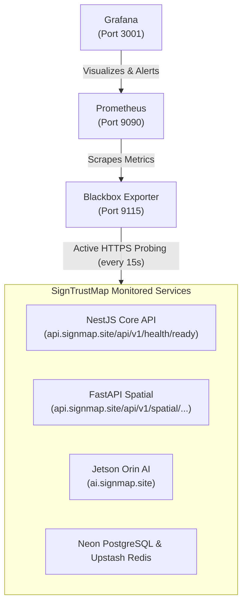

# SignTrustMap — Production Health & Performance Monitoring Stack

This directory contains a turn-key, pre-provisioned monitoring stack using **Prometheus**, **Blackbox Exporter**, and **Grafana** to monitor all distributed SignTrustMap microservices and infrastructure.

---

## 🏗️ Architecture



---

## 🚀 Quick Start (Running Locally or on Jetson Orin)

### 1. Start the Stack
From `signtrustmap-backend`:
```bash
docker compose -f infra/monitoring/docker-compose.monitoring.yml up -d
```

### 2. Access Grafana Dashboard
- **URL**: [http://localhost:3001](http://localhost:3001)
- **Default Credentials**: `admin` / `admin` (or view directly without login via enabled Anonymous Viewer mode)
- **Dashboard**: Open **Dashboards** → **SignTrustMap** → **SignTrustMap — Global Health & Uptime**

### 3. Stop the Stack
```bash
docker compose -f infra/monitoring/docker-compose.monitoring.yml down
```

---

## 📊 What's Included in the Dashboard

1. **Real-time Status Badges**:
   - 🟢 **NestJS Core API** (`api.signmap.site/api/v1/health/ready`)
   - 🟢 **FastAPI Spatial GIS** (`api.signmap.site/api/v1/spatial`)
   - 🟢 **Jetson Orin AI Inference** (`ai.signmap.site`)
   - 🟢 **Neon PostgreSQL Database** (verified via NestJS `/api/v1/health/ready`)
2. **Response Latency (Time-Series)**:
   - Live chart tracking endpoint latency over time with green/yellow/red SLA thresholds.
3. **24h Availability SLA (%)**:
   - Availability gauge showing percentage uptime over rolling 24 hours.
4. **SSL Certificate Expiration Countdown**:
   - Real-time countdown in days for Let's Encrypt / Google Trust Services TLS certificates. Triggers warnings when `< 14` days remaining.
5. **HTTP Status Code History**:
   - Historical chart showing 200 OK responses vs 4xx/5xx errors.

---

## 🔔 Setting Up Notifications (Discord / Telegram / Slack / Email)

In Grafana:
1. Navigate to **Alerting** → **Contact points**.
2. Click **+ Add contact point**.
3. Choose your provider:
   - **Discord**: Select `Discord` and paste your Discord Webhook URL.
   - **Telegram**: Select `Telegram`, enter your Telegram BOT API Token and Chat ID.
   - **Slack**: Select `Slack` and paste your Slack Incoming Webhook URL.
   - **Email**: Select `Email` and enter your destination address.
4. Click **Test** → **Save contact point**.
5. Under **Notification policies**, set the default policy to your new contact point.

---

## ☁️ Option 2: Grafana Cloud (Free Forever SaaS)

If you prefer not to host Docker on your machine or Jetson Orin 24/7:
1. Create a free account at [https://grafana.com](https://grafana.com).
2. In the Grafana Cloud menu, go to **Testing & Synthetics** → **Synthetic Monitoring**.
3. Click **Add check**:
   - **Check Type**: `HTTP`
   - **Check Name**: `NestJS Core API`
   - **URL**: `https://api.signmap.site/api/v1/health/ready`
   - **Frequency**: `1m`
   - **Probe Locations**: Choose Singapore, Tokyo, and Frankfurt.
4. Repeat for `https://api.signmap.site/api/v1/spatial/health` and `https://ai.signmap.site/health`.
5. Grafana Cloud will automatically generate uptime dashboards and send alerts when any probe fails.
